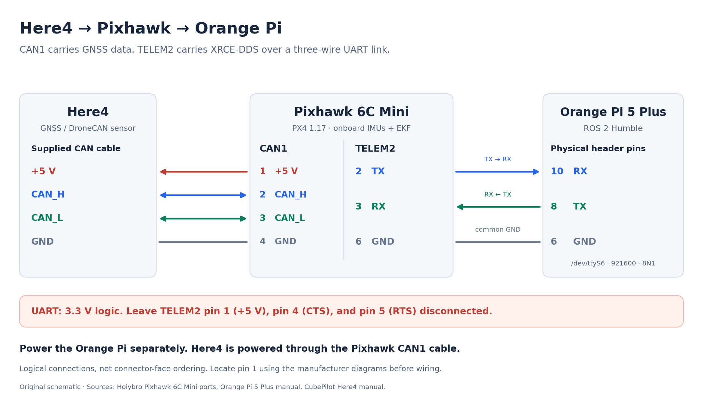
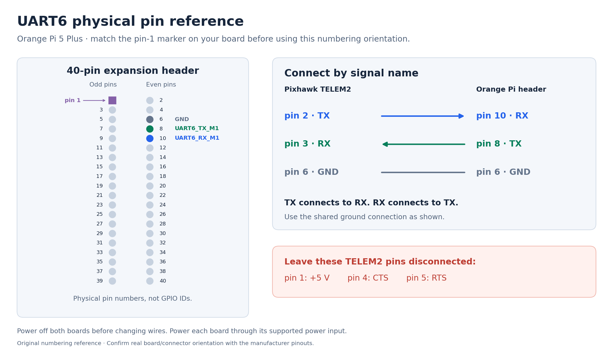

# GPS and EKF position loggers — PX4 1.17 / ROS 2 Humble

This workspace has two independent ROS 2 nodes: one logs the Here4 GPS position,
and the other logs PX4's selected fused global navigation position. Both receive
data already forwarded by your Micro XRCE-DDS Agent on the Orange Pi. Each node
prints its own position data and writes a separate CSV for every confirmed armed
session. They can run individually or together using the same agent.
Both nodes only receive vehicle telemetry and leave the serial link to the agent.

Data path:

```text
Here4 + IMU → Pixhawk 6C Mini / PX4 → serial → MicroXRCEAgent → ROS 2
                                                              ├─ GPS logger → ~/gps_logs/
                                                              └─ EKF logger → ~/ekf_logs/
```

## Hardware and serial setup

This setup targets **Orange Pi 5 Plus**, **Pixhawk 6C Mini / PX4 1.17**,
**Here4 on CAN1**, and **ROS 2 Humble on Ubuntu 22.04 ARM64**. The Orange Pi
UART6 connection uses `/dev/ttyS6` at **921600 baud, 8N1**. The physical header
pins below are specific to the **5 Plus**; other Orange Pi models differ.

### Wiring



Connect Here4 to **CAN1** with its supplied four-wire DroneCAN cable. Insert a
working microSD card in the Pixhawk before using dynamic node-ID allocation.
CAN1 avoids the CAN2 dynamic allocation limitation documented by PX4.
Keep the CAN bus correctly terminated at its two ends.
[Here4 manual](https://docs.cubepilot.org/here-4/here-4-manual),
[PX4 1.17 DroneCAN setup](https://docs.px4.io/v1.17/en/dronecan/).

With both boards powered off, connect these **three UART wires**:

| Pixhawk 6C Mini TELEM2 | Orange Pi 5 Plus 40-pin header | Direction |
| --- | --- | --- |
| Pin **2**, TX, 3.3 V signal | Physical pin **10**, `UART6_RX_M1` | Pixhawk → Orange Pi |
| Pin **3**, RX, 3.3 V signal | Physical pin **8**, `UART6_TX_M1` | Orange Pi → Pixhawk |
| Pin **6**, GND | Physical pin **6**, GND | Common ground |

Leave TELEM2 **pin 1 (+5 V)**, **pin 4 (CTS)**, and **pin 5 (RTS)** disconnected
for this three-wire link. Power the Orange Pi through its own power input and
the Pixhawk through a supported power source. The UART connection carries
**3.3 V logic**, not RS-232 voltage levels. Here4 receives power from the
Pixhawk CAN connector; its four-wire CAN connection is separate from UART.
[Holybro port pinouts](https://docs.holybro.com/autopilot/pixhawk-6c-mini/pixhawk-6c-mini-ports).



These are original connection diagrams, not connector-face photographs. Locate
the real **pin 1** marks before counting; turning the board or connector over
changes the apparent left/right order. Use the 40-pin header for UART6, not the
separate debug-console header. Check the
[Orange Pi 5 Plus manufacturer pinout and UART guide](https://www.orangepi.org/orangepiwiki/index.php/Orange_Pi_5_Plus#40_Pin_Expansion_Interface_Pin_Instructions).
Editable SVG versions and source references are in [docs/images](docs/images/README.md).

### Enable UART6 on the Orange Pi

On the official Orange Pi Ubuntu image, run:

```bash
sudo orangepi-config
```

Choose **System → Hardware**, enable **`uart6-m1`** (some image versions label
it UART6), save, exit, and reboot:

```bash
sudo reboot
```

Reconnect after reboot and check the serial device:

```bash
ls -l /dev/ttyS6
sudo dmesg | grep -E 'ttyS6|serial'
```

Menu names and device-tree overlays depend on the installed image/kernel. If
`orangepi-config` is missing or the overlay is named differently, use the
instructions for your **Orange Pi 5 Plus image**. A `/dev/ttyS6` device file
alone does not prove that the pins have the correct UART mux enabled.

### Install the Micro XRCE-DDS Agent

ROS 2 Humble must already be installed; for a new OS use the official
[Humble Ubuntu installation instructions](https://docs.ros.org/en/humble/Installation/Ubuntu-Install-Debs.html).
Build the agent separately from `gps_ws`. The commands below use the clone and
Make workflow and assume a fresh source directory.

In a fresh terminal, install the build tools and build/install the agent:

```bash
sudo apt update
sudo apt install -y git cmake build-essential libssl-dev

cd ~
git clone https://github.com/eProsima/Micro-XRCE-DDS-Agent.git
cd Micro-XRCE-DDS-Agent
# Consider checking out a specific tag/release if latest 'main' causes issues.
mkdir build && cd build
cmake ..
make
sudo make install
sudo ldconfig /usr/local/lib/
```

The first build downloads dependencies and needs an Internet connection.
If that source directory already exists, check its revision before reusing it;
the clone command intentionally does not overwrite an existing checkout.
Check the source version, installation, and shared libraries:

```bash
git -C ~/Micro-XRCE-DDS-Agent rev-parse --short HEAD
command -v MicroXRCEAgent
ldd /usr/local/bin/MicroXRCEAgent
```

Record the printed commit revision; `ldd` should show no `not found` libraries.
The commands below use the source-installed **`MicroXRCEAgent`** executable.
If `main` is incompatible with PX4 1.17 / Humble, the
[PX4 1.17 bridge guide](https://docs.px4.io/v1.17/en/middleware/uxrce_dds#build-run-within-ros-2-workspace)
lists **v2.4.2** as the compatible Humble release.
[Agent source/build configuration](https://github.com/eProsima/Micro-XRCE-DDS-Agent).

## PX4 parameters in QGroundControl

Connect QGroundControl to the Pixhawk over USB. Open **Vehicle Setup →
Parameters** and set/check the values below. USB remains the QGC connection;
TELEM2 is dedicated to XRCE-DDS.

### Here4 / DroneCAN

| Parameter | Value | Purpose |
| --- | --- | --- |
| `UAVCAN_ENABLE` | **2** | Sensors Automatic Config; dynamic node-ID allocation |
| `UAVCAN_SUB_GPS` | **1** | Receive GNSS data from Here4 |
| `UAVCAN_SUB_MAG` | **1** | Receive the Here4 compass; calibrate it in QGC |
| `UAVCAN_BITRATE` | **1000000** | Nominal CAN bitrate; must match the Here4 bus configuration |

Set `UAVCAN_ENABLE`, reboot, then verify the subscription parameters and reboot
after any further changes. `UAVCAN_SUB_BARO=1` is optional if you also want the
Here4 barometer available to PX4. This logger does not require that barometer.
If Here4 is your only GPS, `GPS_1_CONFIG=0` can disable an unused serial GPS
driver; it is not the switch that enables DroneCAN. Do not use a UART baud-rate
value of zero as a substitute for disabling a GPS port.
[PX4 DroneCAN parameter definitions](https://github.com/PX4/PX4-Autopilot/blob/release/1.17/src/drivers/uavcan/uavcan_params.c).

### TELEM2 / XRCE-DDS

| Parameter | Value | Purpose |
| --- | --- | --- |
| `UXRCE_DDS_CFG` | **102 — TELEM 2** | Start the client on Pixhawk TELEM2 |
| `SER_TEL2_BAUD` | **921600** | Match the Orange Pi agent baud rate |
| `MAV_1_CONFIG` | **0**, if currently assigned to TELEM2 | Release TELEM2 from the default second MAVLink instance |
| `UXRCE_DDS_DOM_ID` | **0** | Match `ROS_DOMAIN_ID=0` in the logger terminals |
| `UXRCE_DDS_KEY` | **1** | Nonzero key for this single-Pixhawk setup |
| `UXRCE_DDS_NS_IDX` | **-1** | Keep the default `/fmu/...` topic names |
| `UXRCE_DDS_PTCFG` | **0** | Default DDS participant configuration |
| `UXRCE_DDS_SYNCT` | **1** | Keep bridge time synchronization enabled |

If a different `MAV_*_CONFIG` or another driver owns TELEM2, release **that**
assignment instead. Preserve the MAVLink connection used by QGC.
`UXRCE_DDS_CFG=102` selects the **Pixhawk TELEM2 port**; `/dev/ttyS6` selects
the **Orange Pi UART6 port**. The two port numbers do not need to match.
`UXRCE_DDS_PRT` is a **UDP port** and does not set serial baud rate.
Save the parameters and **reboot the Pixhawk** before starting the agent.
[PX4 1.17 serial/bridge settings](https://docs.px4.io/v1.17/en/middleware/uxrce_dds#starting-the-client),
[PX4 1.17 parameter reference](https://docs.px4.io/v1.17/en/advanced_config/parameter_reference#UXRCE_DDS_CFG).

For the normal GPS-aided EKF, keep GNSS position/altitude/velocity aiding
enabled (`EKF2_GPS_CTRL=7` is the standard bitmask). Preserve a deliberately
configured custom aiding setup. Complete the normal airframe and sensor
calibration, and wait for a usable GNSS fix; enabling serial communications
alone does not make an EKF estimate valid.

To check the PX4 side, use **QGC → Analyze Tools → MAVLink Console**:

```text
uxrce_dds_client status
uavcan status
listener vehicle_gps_position
listener vehicle_global_position
```

These are **PX4 console commands**, not Orange Pi shell commands.

## Build on the Orange Pi

For a new workspace, clone the repository once (or copy the existing source):

```bash
git clone https://github.com/Amir-sut82/gps_ws.git ~/gps_ws
```

The official `px4_msgs` source for `release/1.17` is included in `src/px4_msgs`.
Its exact revision is recorded in `px4_msgs.repos`. Build on the Orange Pi even
if you copied this workspace from another computer: compiled files are specific
to the computer architecture. Copy `src/`, `scripts/`, and `px4_msgs.repos`;
exclude `build/`, `install/`, and `log/` when transferring to another machine.

With ROS 2 Humble and colcon installed:

```bash
cd ~/gps_ws
source /opt/ros/humble/setup.bash
export CMAKE_BUILD_PARALLEL_LEVEL=2
export MAKEFLAGS=-j2
colcon build --symlink-install --executor sequential \
  --packages-up-to here4_logger --cmake-args -DBUILD_TESTING=OFF
```

If dependencies are missing, install them with rosdep and repeat the build:

```bash
rosdep install --from-paths src --ignore-src --rosdistro humble -r -y
```

Use the included PX4 1.17 messages when sourcing this workspace. Sourcing
another workspace containing a different `px4_msgs` afterward can select
incompatible message definitions.

## Run

In terminal 1 on the Orange Pi, run your existing agent command. Keep one agent
running for this serial link; leave it running if it is already connected:

```bash
sudo MicroXRCEAgent serial --dev /dev/ttyS6 -b 921600
```

Expected agent output includes `session established`, followed by topic and
data-writer creation. One agent serves both loggers; keep it running in this
terminal. The agent is started with `sudo` for serial-port access, while the
ROS 2 logger nodes run as your normal user.

For a PX4 client configured to use **UDP/network transport**, the alternative
agent command is:

```bash
MicroXRCEAgent udp4 -p 8888 #Only for testing XRCE Agent
```

Configure the PX4 client with the Orange Pi's network address and UDP port
**8888** for that option. Use the serial command for the TELEM2/UART6 wiring
described above.

In each logger terminal, use the same domain as the PX4 parameter above:

```bash
export ROS_DOMAIN_ID=0
export ROS_LOCALHOST_ONLY=0
```

For the Here4 GPS position, run in terminal 2:

```bash
cd ~/gps_ws
./scripts/start_gps_logger.sh
```

For the fused EKF navigation position, run this instead, or in terminal 3 to
record both sources simultaneously:

```bash
cd ~/gps_ws
./scripts/start_ekf_logger.sh
```

`./scripts/start_logger.sh` remains an alias for the original GPS launch command.

To start either executable directly, first source the workspace in that terminal:

```bash
source /opt/ros/humble/setup.bash
source ~/gps_ws/install/setup.bash
export ROS_DOMAIN_ID=0
export ROS_LOCALHOST_ONLY=0
```

Then choose one command:

| Source | Direct executable | Launch command | Default CSV directory |
| --- | --- | --- | --- |
| Here4 GPS | `ros2 run here4_logger gps_logger` | `ros2 launch here4_logger logger.launch.py` | `~/gps_logs/` |
| Fused EKF | `ros2 run here4_logger ekf_logger` | `ros2 launch here4_logger ekf_logger.launch.py` | `~/ekf_logs/` |

The scripts and launch commands load their respective YAML configuration files.
Direct `ros2 run` commands use the same built-in defaults. To apply edited YAML
when using `ros2 run`, supply it explicitly:

```bash
ros2 run here4_logger gps_logger --ros-args \
  --params-file ~/gps_ws/src/here4_logger/config/logger.yaml
```

```bash
ros2 run here4_logger ekf_logger --ros-args \
  --params-file ~/gps_ws/src/here4_logger/config/ekf_logger.yaml
```

Each terminal displays latitude, longitude, MSL altitude, accuracy estimates,
arming state, and data age at 1 Hz. The GPS node also shows fix/RTK state,
satellites and speed. The EKF node shows `lat_lon_valid`, `alt_valid`, and
`dead_reckoning`. Logging records **every position message received while armed**,
independently of the display rate. Each node subscribes only to its own position
source plus vehicle status, and maintains its own recording session.

## Logging behavior

- A confirmed armed state starts a new CSV, even if the logger starts while
  the vehicle is already armed. Repeated armed messages keep the same file.
- Disarming closes and syncs the file. The terminal prints its full path and
  number of samples. The next arm creates a different file.
- An arm request rejected by PX4 creates no session. This tracks actual state,
  not the RC switch or command request.
- Ctrl+C closes and saves an active file. Position samples already received before
  a confirmed arm are not added retroactively.
- Missing or stale position/status data is marked in the terminal. If status stops
  while armed, incoming positions continue to be recorded with `status_fresh=False`.
  A changed PX4 `armed_time` starts a new file if a disarm/rearm transition was
  missed. Data and entire sessions lost during a DDS interruption cannot be
  recovered by this receiver.
- Invalid positions are retained with source-specific validity fields for later filtering.
- Each row is flushed to the OS immediately. Files are synced to storage every
  second and on close. Abrupt power loss can still lose recent writes.

Files use different directories and prefixes:

```text
~/gps_logs/position_20261109T120000_123456Z_a1b2c3d4.csv
~/ekf_logs/ekf_position_20261109T120000_234567Z_e5f6a7b8.csv
```

Even if you configure the same directory for both nodes, their files have
different prefixes. Use `armed_time_us` to identify the same arming session
across both logs; files are created independently when each node receives status.

Filenames and `received_utc` use UTC. `received_utc` is the Orange Pi receive
time, so its system clock should be correct. The original PX4 timestamps and
GPS UTC timestamp (GPS logs only) are also preserved. No conversion between those
clock domains is assumed. A GPS UTC timestamp of zero means it is unavailable.

Important CSV columns:

| Columns | Meaning / units |
| --- | --- |
| `latitude_deg`, `longitude_deg` | GPS coordinates in degrees; original float64 precision |
| `altitude_msl_m`, `altitude_ellipsoid_m` | Meters above mean sea level / WGS84 ellipsoid |
| `fix_type`, `fix_name` | GPS only: 3 = 3D, 4 = DGPS, 5 = RTK float, 6 = RTK fixed |
| `position_3d_valid` | Finite coordinates/altitude within coordinate bounds, plus a 3D-or-better fix for GPS or both PX4 validity flags for EKF; does not certify accuracy |
| `eph`, `epv` | Horizontal and vertical accuracy estimates in meters |
| `vel_m_s`, `vel_n_m_s`, `vel_e_m_s`, `vel_d_m_s` | GPS only: speed / North-East-Down velocity in m/s; Down is positive downward |
| `vel_ned_valid` | GPS only: whether the receiver considers the NED velocity valid |
| `timestamp`, `timestamp_sample`, `status_timestamp_us`, `armed_time_us` | Original PX4 timestamps in microseconds |
| `time_utc_usec` | GPS only: receiver GPS UTC timestamp in microseconds |
| `session_elapsed_s`, `status_age_s`, `status_fresh` | Receive-time session elapsed time and status freshness |
| `device_id`, `satellites_used`, `rtcm_*` | GPS only: device, satellite count, and correction diagnostics |
| `lat_lon_valid`, `alt_valid` | EKF only: PX4's validity flags for the horizontal and vertical estimate |
| `dead_reckoning` | EKF only: true when the estimate is being propagated through dead reckoning |
| `lat_lon_reset_counter`, `alt_reset_counter`, `terrain_reset_counter`, `delta_alt`, `delta_terrain` | EKF only: estimator reset diagnostics, deltas in meters |
| `terrain_alt`, `terrain_alt_valid` | EKF only: terrain altitude estimate and its validity |
| `arming_state`, `nav_state`, `failsafe` | Most recently received PX4 status |

The GPS CSV also retains receiver fields including heading, dilution of precision,
jamming, spoofing, and authentication diagnostics under their original PX4 names.
These are GPS positions from the PX4 GPS pipeline, not the fused
EKF `vehicle_global_position` estimate. If multiple GPS units are configured,
PX4 may select or blend their data; this node does not select a receiver.

The EKF node reads `/fmu/out/vehicle_global_position`, the fused global position
exported by PX4's selected navigation estimator. With EKF2 configured this is the
EKF output used for navigation, rather than an individual `estimator_global_position`
instance or a requested position setpoint. The logger does not perform additional
sensor fusion. This estimate can include GPS, IMU, and other configured sensors.
An EKF estimate is not guaranteed ground truth: the CSV retains PX4's validity,
error, dead-reckoning, and reset information so its quality remains visible.

EKF `lat`, `lon`, `alt`, and `alt_ellipsoid` are exported under the same
`latitude_deg`, `longitude_deg`, `altitude_msl_m`, and `altitude_ellipsoid_m`
column names used by the GPS CSV. Their original degrees/meters units and
received precision are preserved. GPS-only fields are not invented for EKF logs.

## Configuration and topic checks

Edit `src/here4_logger/config/logger.yaml` for GPS, or
`src/here4_logger/config/ekf_logger.yaml` for EKF, before starting. With
`--symlink-install`, edits are used on the next launch. Configuration values
are read at startup. Launch arguments override corresponding YAML settings:

```bash
./scripts/start_gps_logger.sh output_directory:=/home/orangepi/gps_logs
./scripts/start_ekf_logger.sh output_directory:=/home/orangepi/ekf_logs
./scripts/start_ekf_logger.sh px4_namespace:=px4_1
```

Default topic names are derived from the installed message version:

| Topic | Message |
| --- | --- |
| `/fmu/out/vehicle_gps_position` | `px4_msgs/msg/SensorGps` |
| `/fmu/out/vehicle_global_position` | `px4_msgs/msg/VehicleGlobalPosition` (version 0) |
| `/fmu/out/vehicle_status_v1` | `px4_msgs/msg/VehicleStatus` (version 1) |

Both nodes use best-effort, volatile QoS compatible with PX4. If you see
topics but no data, check the actual names, types, publishers, and QoS after
sourcing this workspace:

```bash
source /opt/ros/humble/setup.bash
source ~/gps_ws/install/setup.bash
ros2 topic list -t
ros2 topic info /fmu/out/vehicle_gps_position --verbose
ros2 topic info /fmu/out/vehicle_global_position --verbose
ros2 topic info /fmu/out/vehicle_status_v1 --verbose
ros2 topic echo /fmu/out/vehicle_gps_position --qos-reliability best_effort
```

For a firmware build with different topic names, override them explicitly
after confirming that their message definitions match:

```bash
./scripts/start_logger.sh \
  gps_topic:=/fmu/out/vehicle_gps_position \
  status_topic:=/fmu/out/vehicle_status_v1
```

```bash
./scripts/start_ekf_logger.sh \
  ekf_topic:=/fmu/out/vehicle_global_position \
  status_topic:=/fmu/out/vehicle_status_v1
```

Keep `ROS_DOMAIN_ID` and the DDS environment consistent with the environment
where your agent's topics are already visible. Keep your working agent/PX4
serial configuration. This workspace needs neither MAVROS nor another serial
connection.

## Arming from QGC and optional PX4 SD logs

Start the agent and the desired logger nodes before using QGC's normal Arm /
Disarm control. Each node starts its CSV only after PX4 reports **armed** and
closes it after PX4 reports **disarmed**. A rejected arm request creates no new
session. Both nodes continue to display incoming data while disarmed.

If QGC reports an arming failure, inspect the exact check and fix its cause
(power, calibration, manual control configuration, or navigation validity).
Allowing arming without GPS would not create a valid EKF global position.
Use the EKF validity fields in the terminal and CSV to assess the received data.

For an additional `.ulg` recording on the **Pixhawk microSD card**, leave
`SDLOG_MODE=0` to record from arm to disarm; `SDLOG_PROFILE=1` is the default
topic set. `SDLOG_MODE=2` instead records the PX4 SD log from boot to shutdown.
These SD settings do **not** control the Orange Pi CSV files, which still use
the armed-state behavior implemented by the ROS nodes.
[PX4 SD logging parameters](https://docs.px4.io/v1.17/en/advanced_config/parameter_reference#SDLOG_MODE).

## Serial connection troubleshooting

Run these on the **Orange Pi**, not on a laptop that has no UART6 header:

```bash
ls -l /dev/ttyS6
sudo dmesg | grep -E 'ttyS6|serial'
sudo fuser -v /dev/ttyS6
systemctl status serial-getty@ttyS6.service
```

- **Device missing / input-output error:** check the UART6-M1 overlay, reboot,
  and confirm that this OS image maps that header UART to `/dev/ttyS6`.
- **Device busy:** stop the other agent or program listed by `fuser`; only one
  agent can own this serial connection.
- **Serial login service owns UART6:** if `serial-getty@ttyS6.service` is
  actually using this port, disable that service with
  `sudo systemctl disable --now serial-getty@ttyS6.service`. Also check whether
  the image assigns a kernel console to this UART. Keep a separate debug/SSH
  console available while changing console assignments.
- **Agent runs but no PX4 session:** check crossed TX/RX, common ground,
  matching 921600 baud, the TELEM2 assignment, and the Pixhawk reboot.
- **Session established but ROS receives nothing:** check the matching PX4
  1.17 messages, domain 0, namespace, sensor-data QoS, and a compatible agent release.
  In a sourced logger terminal, run `ros2 daemon stop` and then
  `ros2 topic list -t` after correcting the DDS environment.

For this installation the start command remains:

```bash
sudo MicroXRCEAgent serial --dev /dev/ttyS6 -b 921600
```

## Tests

Recorder tests without hardware or ROS discovery:

```bash
cd ~/gps_ws
PYTHONPATH=src/here4_logger python3 -m pytest -q src/here4_logger/test
```

After building, run the optional DDS test in its isolated domain. It publishes
synthetic GPS/EKF/status data on domain 88 and checks each node's CSV rotation,
terminal output, precision, invalid EKF flags, saving on Ctrl+C, and separate
recording when both nodes run together:

```bash
source /opt/ros/humble/setup.bash
source ~/gps_ws/install/setup.bash
ROS_DOMAIN_ID=88 ROS_LOCALHOST_ONLY=1 HERE4_RUN_DDS_TESTS=1 \
  python3 -m pytest -q src/here4_logger/test/test_dds.py
```

Reference definitions: [PX4 1.17 SensorGps](https://github.com/PX4/px4_msgs/blob/release/1.17/msg/SensorGps.msg),
[VehicleGlobalPosition](https://github.com/PX4/px4_msgs/blob/release/1.17/msg/VehicleGlobalPosition.msg),
[VehicleStatus](https://github.com/PX4/px4_msgs/blob/release/1.17/msg/VehicleStatus.msg),
[DDS topic mapping](https://github.com/PX4/PX4-Autopilot/blob/release/1.17/src/modules/uxrce_dds_client/dds_topics.yaml),
and [PX4 ROS 2 subscriber QoS](https://docs.px4.io/main/en/ros2/user_guide#ros-2-subscriber-qos-settings).
